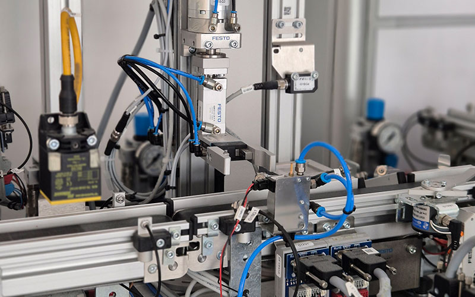
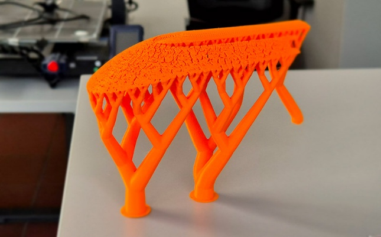
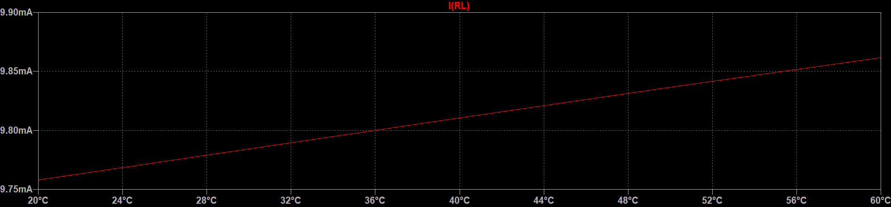
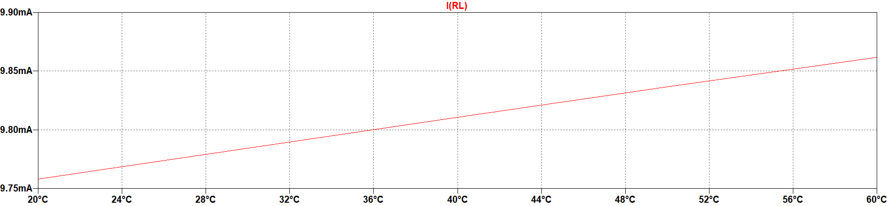

#  {#sec-ergebnisse}

::: {.hcw-lang-de}
Präsentieren Sie die Ergebnisse Ihrer Arbeit. Die Bild- und Tabellenbeispiele
aus den V1-Vorlagen zeigen: Jede Darstellung braucht einen Bezug im Fließtext,
eine verständliche Beschriftung und bei fremden Inhalten eine Quellenangabe.
:::

::: {.hcw-lang-en}
Present the results of your thesis. The figure and table examples from the V1
templates show that every illustration needs a reference in the running
text, an informative caption, and a citation for material from other sources.
:::

##  {#sec-abbildungen-belegen}

::: {.hcw-lang-de}
Sputtern, auch Kathodenzerstäubung genannt, ist ein physikalisches Verfahren,
bei dem Ionen auf einen Festkörper (Target) beschleunigt werden. Der Beschuss
mit energiereichen Ionen im Bereich von $\mathrm{eV}$ bis $\mathrm{keV}$
löst Atome, Atomcluster und Moleküle aus dem Target. Die Materialübertragung
beruht auf Impulsübertragung statt thermischer Anregung. Dadurch eignet sich
das Verfahren auch für hochschmelzende und temperaturempfindliche Materialien.

Target und Substrat befinden sich in einer Hochvakuumkammer; das Arbeitsgas
ist hier Argon. Zwischen dem Target als Kathode und dem Substrat als Anode
findet eine Glimmentladung statt. @fig-magnetron zeigt den Aufbau mit Plasma,
Magneten und Kühlung [@kelly2000]. Das Substrat nimmt das abgeschiedene Material
auf. Eine angelegte Substratspannung kann außerdem zur Reinigung und
Strukturierung der Oberfläche eingesetzt werden.
:::

::: {.hcw-lang-en}
Sputtering is a physical process in which ions are accelerated toward a solid
target. Bombardment with high-energy ions in the $\mathrm{eV}$ to
$\mathrm{keV}$ range ejects atoms, atomic clusters, and molecules. Material
transfer occurs through momentum transfer rather than thermal excitation.
The process can therefore also be used with high-melting-point and
temperature-sensitive materials.

The target and substrate are placed in a high-vacuum chamber; argon is the
working gas here. A glow discharge occurs between the target as the cathode
and the substrate as the anode. @fig-magnetron shows the setup with plasma,
magnets, and cooling [@kelly2000]. The transferred material is deposited on
the substrate. An applied substrate voltage can also be used to clean and
pattern the surface.
:::

![ [@hishimone2020]](../images/v1/magnetron-sputtern.png){#fig-magnetron width=78% fig-pos="H" fig-alt="Magnetron sputtering chamber with cathode, target, plasma, anode, substrate, magnets, and cooling water."}

::: {.hcw-lang-de}
Alle relevanten Beschriftungen innerhalb einer Abbildung müssen klar lesbar
sein. Im Referenzbeispiel begünstigt die vergleichsweise hohe kinetische
Energie der abgeschiedenen Teilchen (etwa $10\,\mathrm{eV}$) dichte Schichten;
die thermische Belastung fällt geringer aus als bei konventionellen
Verdampfungsverfahren [@hossain2023].
:::

::: {.hcw-lang-en}
All relevant labels within a figure must be clearly legible. In the reference
example, the comparatively high kinetic energy of the deposited particles
(approximately $10\,\mathrm{eV}$) promotes dense layers, while thermal stress
is lower than in conventional evaporation processes [@hossain2023].
:::

##  {#sec-bildlayout}

::: {.hcw-lang-de}
Abbildungen sind integraler Bestandteil des Textes. Sie werden eindeutig
referenziert und in der Regel zentriert dargestellt. @fig-buecher übernimmt
das kleine Grafikbeispiel aus der Word-Vorlage. In Quarto wird die Datei
direkt mit Markdown eingebunden; die Platzierung übernimmt LaTeX.

Die Bildunterschrift soll die wesentliche Aussage auch ohne den Fließtext
verständlich machen. Bei fremden Bildern ist die Quellenangabe Teil dieser
Beschriftung.
:::

::: {.hcw-lang-en}
Figures are an integral part of the text. They are clearly referenced and
usually centered. @fig-buecher reproduces the small illustration from the
Word template. In Quarto, the file is inserted directly using Markdown;
LaTeX handles its placement.

The caption should communicate the essential information even without the
running text. For images from other sources, the source citation belongs in
the caption.
:::

{#fig-buecher width=24% fig-pos="H" fig-alt="A small illustration of a stack of books."}

##  {#sec-teilabbildungen}

::: {.hcw-lang-de}
Zusammengesetzte Abbildungen erhalten eine gemeinsame Nummer. Ihre
Teilabbildungen werden mit (a), (b) und so weiter gekennzeichnet. @fig-htm
zeigt zwei Beispiele von der Website des Studiengangs High Tech Manufacturing:
@fig-fertigungsstrasse zeigt eine Fertigungsstraße und @fig-stuetzmaterial
das Stützmaterial eines 3D-Drucks. Beide Teile werden im Text erläutert und
gemeinsam mit ihrer Quelle beschriftet.
:::

::: {.hcw-lang-en}
Composite figures receive one overall number. Their subfigures are labeled
(a), (b), and so on. @fig-htm contains two examples from the website of the
High Tech Manufacturing degree program: @fig-fertigungsstrasse shows a
production line, and @fig-stuetzmaterial shows the support material from a
3D print. Both parts are explained in the text and share an overall caption
with a source citation.
:::

::: {#fig-htm layout-ncol=2 fig-pos="H"}

{#fig-fertigungsstrasse width=100% fig-alt="Automated production line with pneumatic actuators, sensors, and a conveyor."}

{#fig-stuetzmaterial width=100% fig-alt="Orange 3D-printed part supported by a lattice structure."}

 [@hcwhtm2025]

:::

##  {#sec-diagramme}

::: {.hcw-lang-de}
Diagrammachsen brauchen Bezeichnungen, Skalierungen und gegebenenfalls
Einheiten. Die Parameter werden im Text erklärt. @fig-sinussignal zeigt ein
cosinusförmiges Signal mit der Amplitude $\widehat{V}$, der Kreisfrequenz
$\omega$ und dem Nullphasenwinkel $\varphi_0$.
:::

::: {.hcw-lang-en}
Diagram axes need labels, scales, and units where applicable. Parameters are
explained in the text. @fig-sinussignal shows a cosine signal with amplitude
$\widehat{V}$, angular frequency $\omega$, and initial phase angle $\varphi_0$.
:::

$$
v(t) = \widehat{V}\cos(\omega t + \varphi_0),
\qquad T = \frac{2\pi}{\omega}.
$$ {#eq-cosinussignal}

{#fig-sinussignal width=75% fig-pos="H" fig-alt="Cosine curve with amplitude, period, initial phase, and time axes marked."}

::: {.hcw-lang-de}
Die Periodendauer $T$ folgt aus @eq-cosinussignal. Die Vektorgrafik bleibt
auch beim Vergrößern scharf.
:::

::: {.hcw-lang-en}
The period $T$ follows from @eq-cosinussignal. The vector graphic remains sharp
when enlarged.
:::

##  {#sec-kontrast}

::: {.hcw-lang-de}
Achten Sie bei Grafiken und Tabellen auf guten Kontrast. @fig-kontrast zeigt
denselben Signalverlauf auf dunklem und hellem Hintergrund. Die untere
Darstellung ist für Ausdrucke besser geeignet und benötigt weniger Toner
beziehungsweise Tinte.
:::

::: {.hcw-lang-en}
Choose good contrast for figures and tables. @fig-kontrast shows the same
signal curve on dark and light backgrounds. The lower version is better
suited to printing and uses less toner or ink.
:::

::: {#fig-kontrast layout-ncol=1 fig-pos="H"}

{width=100% fig-alt="Red signal trace on a dark background with low contrast."}

{width=100% fig-alt="The same signal trace on a light background."}



:::

##  {#sec-tabellen-querformat}

::: {.hcw-lang-de}
Tabellen werden im Fließtext referenziert und kurz erläutert. Stammen die
Daten aus einer fremden Quelle, wird diese in der Beschriftung oder einer
Anmerkung genannt. @tbl-v1-beispiel zeigt die einfache Tabellenstruktur
aus der Referenzvorlage.
:::

::: {.hcw-lang-en}
Tables are referenced and briefly explained in the running text. If the data
comes from another source, cite it in the caption or a table note.
@tbl-v1-beispiel shows the simple table structure from the reference template.
:::

|  |  |  |
|---|---|---|
| 11 | 12 | 13 |
| 21 | 22 | 23 |
| 31 | 32 | 33 |

:  {#tbl-v1-beispiel}

::: {.hcw-lang-de}
Eine als Grafik importierte Tabelle bleibt inhaltlich eine Tabelle und wird
entsprechend nummeriert. @tbl-dft-fft vergleicht die Anzahl komplexwertiger
Multiply-and-Accumulate-Operationen (MAC) für eine DFT und eine FFT bei
unterschiedlichen Transformationslängen $N$.
:::

::: {.hcw-lang-en}
A table imported as a graphic is still a table and is numbered accordingly.
@tbl-dft-fft compares the number of complex multiply-and-accumulate (MAC)
operations required by a DFT and an FFT for different transform lengths $N$.
:::

::: {#tbl-dft-fft tbl-pos="H"}

{width=65%}



:::

::: {.hcw-lang-de}
Große Tabellen oder Grafiken erhalten eine eigene Seite, bei Bedarf im
Querformat. @tbl-wahrscheinlichkeiten übernimmt die Übersicht wichtiger
Wahrscheinlichkeitsverteilungen aus der V1-Vorlage. Querformatseiten sollen
einheitlich vom rechten Seitenrand aus lesbar sein.
:::

::: {.hcw-lang-en}
Large tables or figures should be placed on a separate page, in landscape
orientation if necessary. @tbl-wahrscheinlichkeiten reproduces the overview
of important probability distributions from the V1 template. Landscape pages
should consistently be readable from the right margin.
:::

~~~{=latex}
\clearpage
\begin{landscape}
~~~

::: {#tbl-wahrscheinlichkeiten tbl-pos="H"}

{width=100%}

 $p_{\mathrm{x}}(x)$: ;
$\mu_{\mathrm{x}}$: ;
$\sigma_{\mathrm{x}}^2$: ;
$\delta(x)$: ;
$P$: .

:::

::: {.hcw-lang-de}
Hinweis zur Originalgrafik: Bei der Gleichverteilung ist $(b-a)^2/12$ die
Varianz $\sigma_{\mathrm{x}}^2$, nicht die Standardabweichung
$\sigma_{\mathrm{x}}$. In der unverändert übernommenen Grafik fehlt
an dieser Stelle das Quadrat am Varianzsymbol.
:::

::: {.hcw-lang-en}
Note on the original graphic: For the uniform distribution, $(b-a)^2/12$
is the variance $\sigma_{\mathrm{x}}^2$, not the standard deviation
$\sigma_{\mathrm{x}}$. The graphic reproduced from the source omits
the square on the variance symbol at this point.
:::

~~~{=latex}
\end{landscape}
~~~
