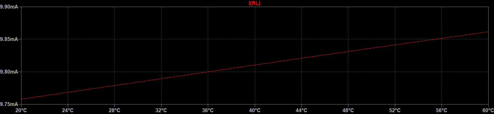
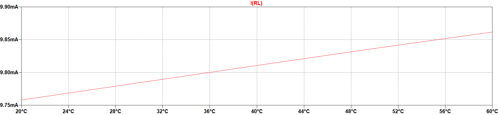

# Ergebnisse {#sec-ergebnisse}

Präsentieren Sie die Ergebnisse Ihrer Arbeit. Die Bild- und Tabellenbeispiele
aus den V1-Vorlagen zeigen: Jede Darstellung braucht einen Bezug im Fließtext,
eine verständliche Beschriftung und bei fremden Inhalten eine Quellenangabe.

## Abbildungen erklären und belegen {#sec-abbildungen-belegen}

Sputtern, auch Kathodenzerstäubung genannt, ist ein physikalisches Verfahren,
bei dem Ionen auf einen Festkörper (Target) beschleunigt werden. Der Beschuss
mit energiereichen Ionen im Bereich von $\mathrm{eV}$ bis $\mathrm{keV}$
löst Atome, Atomcluster und Moleküle aus dem Target. Die Materialübertragung
beruht auf Impulsübertragung statt thermischer Anregung. Dadurch eignet sich
das Verfahren auch für hochschmelzende und temperaturempfindliche Materialien.

Target und Substrat befinden sich in einer Hochvakuumkammer; das Arbeitsgas
ist hier Argon. Zwischen dem Target als Kathode und dem Substrat als Anode
findet eine Glimmentladung statt. @fig-magnetron zeigt den Aufbau mit Plasma,
Magneten und Kühlung [@kelly2000]. Das Substrat nimmt das abgeschiedene Material
auf. Eine angelegte Substratspannung kann außerdem zur Reinigung und
Strukturierung der Oberfläche eingesetzt werden.

![Schaltschematische Darstellung eines Magnetron-Sputterprozesses. [@hishimone2020]](../../images/v1/magnetron-sputtern.png){#fig-magnetron width=78% fig-pos="H" fig-alt="Magnetron-Sputterkammer mit Kathode, Target, Plasma, Anode, Substrat, Magneten und Kühlwasser."}

Alle relevanten Beschriftungen innerhalb einer Abbildung müssen klar lesbar
sein. Im Referenzbeispiel begünstigt die vergleichsweise hohe kinetische
Energie der abgeschiedenen Teilchen (etwa $10\,\mathrm{eV}$) dichte Schichten;
die thermische Belastung fällt geringer aus als bei konventionellen
Verdampfungsverfahren [@hossain2023].

## Einbindung und Beschriftung {#sec-bildlayout}

Abbildungen sind integraler Bestandteil des Textes. Sie werden eindeutig
referenziert und in der Regel zentriert dargestellt. @fig-buecher übernimmt
das kleine Grafikbeispiel aus der Word-Vorlage. In Quarto wird die Datei
direkt mit Markdown eingebunden; die Platzierung übernimmt LaTeX.

Die Bildunterschrift soll die wesentliche Aussage auch ohne den Fließtext
verständlich machen. Bei fremden Bildern ist die Quellenangabe Teil dieser
Beschriftung.

{#fig-buecher width=24% fig-pos="H" fig-alt="Kleine Illustration eines Bücherstapels."}

## Mehrere Teilabbildungen {#sec-teilabbildungen}

Zusammengesetzte Abbildungen erhalten eine gemeinsame Nummer. Ihre
Teilabbildungen werden mit (a), (b) und so weiter gekennzeichnet. @fig-htm
zeigt zwei Beispiele von der Website des Studiengangs High Tech Manufacturing:
@fig-fertigungsstrasse zeigt eine Fertigungsstraße und @fig-stuetzmaterial
das Stützmaterial eines 3D-Drucks. Beide Teile werden im Text erläutert und
gemeinsam mit ihrer Quelle beschriftet.

::: {#fig-htm layout-ncol=2 fig-pos="H"}

{#fig-fertigungsstrasse width=100% fig-alt="Automatisierte Fertigungsstraße mit pneumatischen Aktoren, Sensoren und Förderband."}

{#fig-stuetzmaterial width=100% fig-alt="Orangefarbenes 3D-Druckteil mit gitterförmigem Stützmaterial."}

Beispielbilder aus dem Studiengang High Tech Manufacturing. [@hcwhtm2025]

:::

## Diagramme und Signalparameter {#sec-diagramme}

Diagrammachsen brauchen Bezeichnungen, Skalierungen und gegebenenfalls
Einheiten. Die Parameter werden im Text erklärt. @fig-sinussignal zeigt ein
cosinusförmiges Signal mit der Amplitude $\widehat{V}$, der Kreisfrequenz
$\omega$ und dem Nullphasenwinkel $\varphi_0$.

$$
v(t) = \widehat{V}\cos(\omega t + \varphi_0),
\qquad T = \frac{2\pi}{\omega}.
$$ {#eq-cosinussignal}

{#fig-sinussignal width=75% fig-pos="H" fig-alt="Cosinuskurve mit gekennzeichneter Amplitude, Periodendauer, Anfangsphase und Zeitachsen."}

Die Periodendauer $T$ folgt aus @eq-cosinussignal. Die Vektorgrafik bleibt
auch beim Vergrößern scharf.

## Kontrast und Druck {#sec-kontrast}

Achten Sie bei Grafiken und Tabellen auf guten Kontrast. @fig-kontrast zeigt
denselben Signalverlauf auf dunklem und hellem Hintergrund. Die untere
Darstellung ist für Ausdrucke besser geeignet und benötigt weniger Toner
beziehungsweise Tinte.

::: {#fig-kontrast layout-ncol=1 fig-pos="H"}

{width=100% fig-alt="Roter Signalverlauf auf dunklem Hintergrund mit geringem Kontrast."}

{width=100% fig-alt="Derselbe Signalverlauf auf hellem Hintergrund."}

Gleicher Signalverlauf mit schlechtem Kontrast oben und besserem Druckkontrast unten.

:::

## Tabellen und Querformat {#sec-tabellen-querformat}

Tabellen werden im Fließtext referenziert und kurz erläutert. Stammen die
Daten aus einer fremden Quelle, wird diese in der Beschriftung oder einer
Anmerkung genannt. @tbl-v1-beispiel zeigt die einfache Tabellenstruktur
aus der Referenzvorlage.

| Titel 1 | Titel 2 | Titel 3 |
|---|---|---|
| 11 | 12 | 13 |
| 21 | 22 | 23 |
| 31 | 32 | 33 |

: Einfache Beispieltabelle aus der V1-Vorlage. {#tbl-v1-beispiel tbl-colwidths="[33.33,33.34,33.33]"}

Eine als Grafik importierte Tabelle bleibt inhaltlich eine Tabelle und wird
entsprechend nummeriert. @tbl-dft-fft vergleicht die Anzahl komplexwertiger
Multiply-and-Accumulate-Operationen (MAC) für eine DFT und eine FFT bei
unterschiedlichen Transformationslängen $N$.

::: {#tbl-dft-fft tbl-pos="H"}

{width=65%}

Rechenaufwand einer DFT und FFT anhand komplexwertiger MAC-Operationen.

:::

Große Tabellen oder Grafiken erhalten eine eigene Seite, bei Bedarf im
Querformat. @tbl-wahrscheinlichkeiten übernimmt die Übersicht wichtiger
Wahrscheinlichkeitsverteilungen aus der V1-Vorlage. Querformatseiten sollen
einheitlich vom rechten Seitenrand aus lesbar sein.

~~~{=latex}
\clearpage
\begin{landscape}
~~~

::: {#tbl-wahrscheinlichkeiten tbl-pos="H"}

{width=100%}

Überblick zu wichtigen Wahrscheinlichkeitsverteilungen. $p_{\mathrm{x}}(x)$: Wahrscheinlichkeitsdichtefunktion;
$\mu_{\mathrm{x}}$: Erwartungswert;
$\sigma_{\mathrm{x}}^2$: Varianz;
$\delta(x)$: Dirac-Deltafunktion;
$P$: Wahrscheinlichkeit.

:::

Hinweis zur Originalgrafik: Bei der Gleichverteilung ist $(b-a)^2/12$ die
Varianz $\sigma_{\mathrm{x}}^2$, nicht die Standardabweichung
$\sigma_{\mathrm{x}}$. In der unverändert übernommenen Grafik fehlt
an dieser Stelle das Quadrat am Varianzsymbol.

~~~{=latex}
\end{landscape}
~~~
