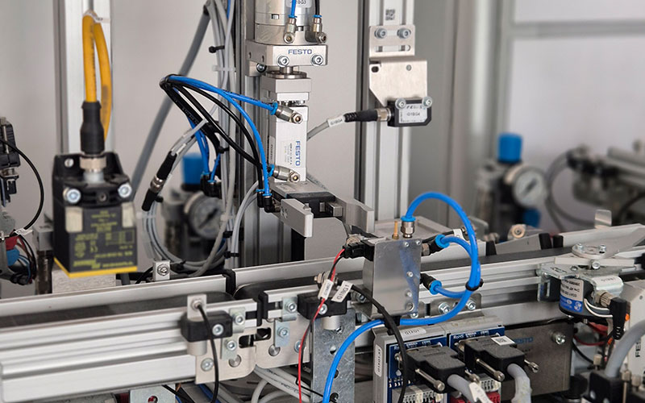
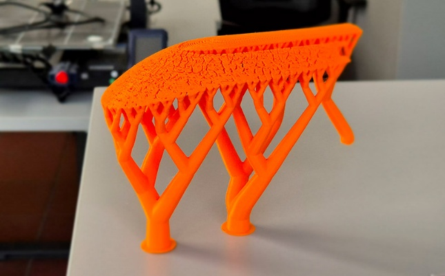
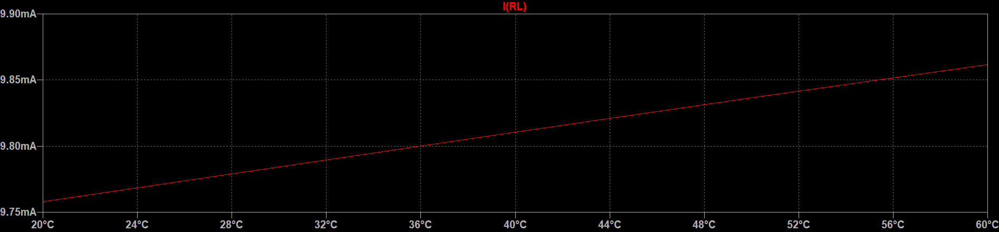
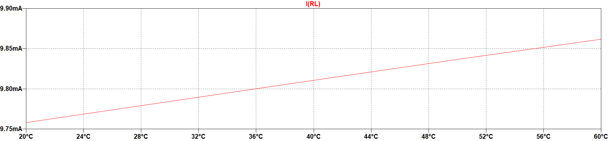

# Results {#sec-ergebnisse}

Present the results of your thesis. The figure and table examples from the V1
templates show that every illustration needs a reference in the running
text, an informative caption, and a citation for material from other sources.

## Explain and cite figures {#sec-abbildungen-belegen}

Sputtering is a physical process in which ions are accelerated toward a solid
target. Bombardment with high-energy ions in the $\mathrm{eV}$ to
$\mathrm{keV}$ range ejects atoms, atomic clusters, and molecules. Material
transfer occurs through momentum transfer rather than thermal excitation.
The process can therefore also be used with high-melting-point and
temperature-sensitive materials.

The target and substrate are placed in a high-vacuum chamber; argon is the
working gas here. A glow discharge occurs between the target as the cathode
and the substrate as the anode. @fig-magnetron shows the setup with plasma,
magnets, and cooling [@kelly2000]. The transferred material is deposited on
the substrate. An applied substrate voltage can also be used to clean and
pattern the surface.

![Schematic diagram of a magnetron sputtering process. [@hishimone2020]](../../images/v1/magnetron-sputtern.png){#fig-magnetron width=78% fig-pos="H" fig-alt="Magnetron sputtering chamber with cathode, target, plasma, anode, substrate, magnets, and cooling water."}

All relevant labels within a figure must be clearly legible. In the reference
example, the comparatively high kinetic energy of the deposited particles
(approximately $10\,\mathrm{eV}$) promotes dense layers, while thermal stress
is lower than in conventional evaporation processes [@hossain2023].

## Placement and captions {#sec-bildlayout}

Figures are an integral part of the text. They are clearly referenced and
usually centered. @fig-buecher reproduces the small illustration from the
Word template. In Quarto, the file is inserted directly using Markdown;
LaTeX handles its placement.

The caption should communicate the essential information even without the
running text. For images from other sources, the source citation belongs in
the caption.

{#fig-buecher width=24% fig-pos="H" fig-alt="A small illustration of a stack of books."}

## Multiple subfigures {#sec-teilabbildungen}

Composite figures receive one overall number. Their subfigures are labeled
(a), (b), and so on. @fig-htm contains two examples from the website of the
High Tech Manufacturing degree program: @fig-fertigungsstrasse shows a
production line, and @fig-stuetzmaterial shows the support material from a
3D print. Both parts are explained in the text and share an overall caption
with a source citation.

::: {#fig-htm layout-ncol=2 fig-pos="H"}

{#fig-fertigungsstrasse width=100% fig-alt="Automated production line with pneumatic actuators, sensors, and a conveyor."}

{#fig-stuetzmaterial width=100% fig-alt="Orange 3D-printed part supported by a lattice structure."}

Sample images from the High Tech Manufacturing degree program. [@hcwhtm2025]

:::

## Diagrams and signal parameters {#sec-diagramme}

Diagram axes need labels, scales, and units where applicable. Parameters are
explained in the text. @fig-sinussignal shows a cosine signal with amplitude
$\widehat{V}$, angular frequency $\omega$, and initial phase angle $\varphi_0$.

$$
v(t) = \widehat{V}\cos(\omega t + \varphi_0),
\qquad T = \frac{2\pi}{\omega}.
$$ {#eq-cosinussignal}

{#fig-sinussignal width=75% fig-pos="H" fig-alt="Cosine curve with amplitude, period, initial phase, and time axes marked."}

The period $T$ follows from @eq-cosinussignal. The vector graphic remains sharp
when enlarged.

## Contrast and printing {#sec-kontrast}

Choose good contrast for figures and tables. @fig-kontrast shows the same
signal curve on dark and light backgrounds. The lower version is better
suited to printing and uses less toner or ink.

::: {#fig-kontrast layout-ncol=1 fig-pos="H"}

{width=100% fig-alt="Red signal trace on a dark background with low contrast."}

{width=100% fig-alt="The same signal trace on a light background."}

The same signal with poor contrast above and better print contrast below.

:::

## Tables and landscape pages {#sec-tabellen-querformat}

Tables are referenced and briefly explained in the running text. If the data
comes from another source, cite it in the caption or a table note.
@tbl-v1-beispiel shows the simple table structure from the reference template.

| Title 1 | Title 2 | Title 3 |
|---|---|---|
| 11 | 12 | 13 |
| 21 | 22 | 23 |
| 31 | 32 | 33 |

: Simple example table from the V1 template. {#tbl-v1-beispiel tbl-colwidths="[33.33,33.34,33.33]"}

A table imported as a graphic is still a table and is numbered accordingly.
@tbl-dft-fft compares the number of complex multiply-and-accumulate (MAC)
operations required by a DFT and an FFT for different transform lengths $N$.

::: {#tbl-dft-fft tbl-pos="H"}

{width=65%}

Computational effort of a DFT and an FFT in complex MAC operations.

:::

Large tables or figures should be placed on a separate page, in landscape
orientation if necessary. @tbl-wahrscheinlichkeiten reproduces the overview
of important probability distributions from the V1 template. Landscape pages
should consistently be readable from the right margin.

~~~{=latex}
\clearpage
\begin{landscape}
~~~

::: {#tbl-wahrscheinlichkeiten tbl-pos="H"}

{width=100%}

Overview of important probability distributions. $p_{\mathrm{x}}(x)$: probability density function;
$\mu_{\mathrm{x}}$: expected value;
$\sigma_{\mathrm{x}}^2$: variance;
$\delta(x)$: Dirac delta function;
$P$: probability.

:::

Note on the original graphic: For the uniform distribution, $(b-a)^2/12$
is the variance $\sigma_{\mathrm{x}}^2$, not the standard deviation
$\sigma_{\mathrm{x}}$. The graphic reproduced from the source omits
the square on the variance symbol at this point.

~~~{=latex}
\end{landscape}
~~~
