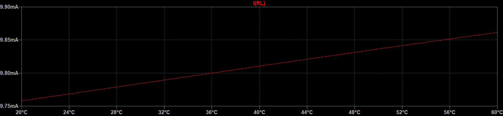
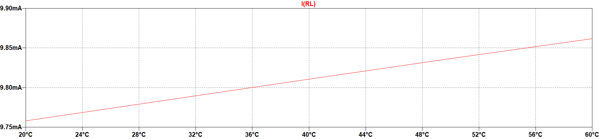

<!-- Wortlaut und Gliederung: HCW_BA/MA_Abschlussarbeit_deutsch_V1.dotx. Technische Ergänzungen ausschließlich am Kapitelende. -->

# Kapitel Überschrift {#sec-kapitel2}

Jedes Kapitel beginnt auf einer neuen Seite. Dies dient der besseren Gliederung des Dokuments und erhöht die Übersichtlichkeit für die Leser\*innenschaft. Innerhalb eines Kapitels gilt dies nicht für Abschnitte und Unterabschnitte, diese folgen unmittelbar dem Fließtext.

## Abschnitt Überschrift {#sec-kapitel2-abschnitt1}

Auch Programmcode kann an passender Stelle eingefügt werden, man beachte dazu Listing \ref{lst-fibonacci} und das Listingverzeichnis am Ende des Dokuments. Programmcode wird in der Schriftart Courier dargestellt, wodurch alle Zeichen die gleiche Breite aufweisen.

```{=latex}
\begin{lstlisting}[caption={Berechnung und Ausgabe einer Folge von Fibonacci-Zahlen.},label={lst-fibonacci}]
#include <stdio.h>
int main()
{
int i, n, t1 = 0, t2 = 1, nextTerm;
printf("Enter the number of terms: ");
scanf("%d", &n);
printf("Fibonacci Series: ");
for (i = 1; i <= n; ++i)
{
printf("%d, ", t1);
nextTerm = t1 + t2;
t1 = t2;
t2 = nextTerm;
}
return 0;
}
\end{lstlisting}
```

Auf eine Überschrift folgt übrigens unmittelbar immer ein Text und nicht sofort eine Abbildung, Tabelle, Gleichung oder ein Listing!

## Abschnitt Überschrift {#sec-kapitel2-abschnitt2}

Wie bereits erwähnt ist eine Gliederung mit nur einem einzelnen Abschnitt zu vermeiden. Deshalb muss es neben Abschnitt \ref{sec-kapitel2-abschnitt1} noch mindestens einen Abschnitt \ref{sec-kapitel2-abschnitt2} geben[^3].

### Unterabschnitt Überschrift {#sec-kapitel2-unterabschnitt1}

Bei der Farbgestaltung von Grafiken und Tabellen ist überdies auf einen guten Kontrast zu achten. Abbildung \ref{fig-kontrast} zeigt zum Vergleich die gleiche Grafik einmal mit schlechtem und einmal mit gutem Kontrast.

::: {#fig-kontrast layout-ncol=1 fig-pos="H" fig-scap="Grafik mit schlechtem (oben) und gutem (unten) Kontrast."}

{width=100%}

{width=100%}

Grafik mit schlechtem (oben) und gutem (unten) Kontrast.

:::

Die untere Grafik in Abbildung \ref{fig-kontrast} mit gutem Kontrast ist zudem für Ausdrucke besser geeignet, weil sie deutlich weniger Toner/Tinte verbraucht!

### Unterabschnitt Überschrift {#sec-kapitel2-unterabschnitt2}

Eine Gliederung mit nur einem einzelnen Unterabschnitt ist wieder zu vermeiden. Es muss deshalb mindestens einen zweiten Unterabschnitt (d. h. auf gleicher Gliederungsebene) geben.

## Hinweise zu Latex {#sec-kapitel2-hinweise}

### Programmcode und Verzeichnisse

Das offizielle C-Beispiel verwendet die LaTeX-Umgebung `lstlisting`. Sie erzeugt die Beschriftung „Listing 2.1“ und den Eintrag im Listingverzeichnis automatisch. Als freie Courier-Alternative wird TeX Gyre Cursor nur für diesen Programmcode verwendet. Der übrige Fließtext bleibt TeX Gyre Heros.

Kapitel beginnen automatisch auf einer neuen Seite. Abschnitte und Unterabschnitte werden mit `##` und `###` geschrieben. Die LaTeX-Satzregeln halten Überschriften mit dem folgenden Text zusammen; feste Seitenzahlen aus Word werden nicht übernommen.

`layout-ncol=1` stellt die beiden Kontrastgrafiken untereinander dar. Verweise und Verzeichnisse werden beim PDF-Build aktualisiert. Weitere Markdown- und LaTeX-Beispiele stehen in `internal/docs/markdown-und-latex.md`.

[^3]: Wegen dieser Fußnote verschiebt sich Abschnitt \ref{sec-kapitel2-abschnitt2} auf eine neue Seite, obwohl auf der vorhergehenden Seite für den Text noch ausreichend Platz zu sein scheint.
