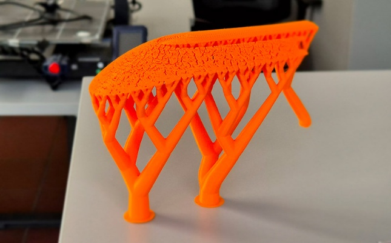

<!-- Wortlaut und Gliederung: HCW_BA/MA_Abschlussarbeit_englisch_V1.dotx. Technische Ergänzungen ausschließlich am Kapitelende. -->

# Chapter title {#sec-kapitel1}

Equations should be integrated into the text, i.e., punctuation should be used appropriately, as in, for example,

```{=latex}
\begin{equation}\label{eq-fourier-transformation}
\underline{U}(\mathrm{j}\omega)=\int_{-\infty}^{\infty}u(t)\,\mathrm{e}^{-\mathrm{j}\omega t}\,\mathrm{d}t\,.
\end{equation}
```

In this equation, $\underline{U}(j\omega)$ denotes the Fourier transform of the time-dependent signal $u(t)$, where $\omega$ is the angular frequency and $\mathrm{j}$ is the imaginary unit. It is important that all variables in the running text be presented in the same font and formatting as in the corresponding equation -- that is, in italics and with mathematical typesetting!

Units and mathematical constants are always set in the same font but upright type (not italicized), both in running text and in mathematical expressions. This serves to clearly distinguish between physical quantities (in italics) and their units or mathematical constants (upright type). For example, in the expression $t = 5\,\mathrm{s}$, the variable (physical quantity) $t$ is written in italics, while the unit "second" ($\mathrm{s}$) -- as well as Euler's number $\mathrm{e}$ and the imaginary unit $\mathrm{j}$ in equation \eqref{eq-fourier-transformation} -- is written in upright type [@austrianstandards2018].

Commas, such as in

```{=latex}
\begin{equation}\label{eq-fourier-invers}
u(t)=\frac{1}{2\pi}\int_{-\infty}^{\infty}\underline{U}(\mathrm{j}\omega)\,\mathrm{e}^{\mathrm{j}\omega t}\,\mathrm{d}\omega\,,
\end{equation}
```

must also be placed correctly in equations. It is not necessary to redefine the variables used here, as they were already introduced in connection with equation \eqref{eq-fourier-transformation}.

Equations are inserted into tables for better alignment and formatting, with the table borders hidden by default. In equation \eqref{eq-fourier-invers}, the borders are still visible as an example for better illustration.

Several related equations, such as those in the system of equations

```{=latex}
\begin{align}
y_1 &= A_{11}x_1+A_{12}x_2 \label{eq-lineares-system-1} \\
y_2 &= A_{21}x_1+A_{22}x_2\,, \label{eq-lineares-system-2}
\end{align}
```

can be grouped together in a single block.

If the individual equations are of different lengths, they should be aligned at the equals sign, as shown in

```{=latex}
\begin{align}
U_2 &= I_{\mathrm{ges}} R_2 \label{eq-spannungen-1} \\
U_{\mathrm{ges}} &= I_{\mathrm{ges}}(R_1+R_2)\,. \label{eq-spannungen-2}
\end{align}
```

In case of long equations, a "line break" is inserted at an appropriate place well before the equation number, as in

```{=latex}
\begin{equation}\label{eq-logarithmusreihe}
\begin{aligned}
\ln(x)&=\sum_{n=1}^{\infty}\frac{(-1)^{n+1}}{n}(x-1)^n=\\
&=(x-1)-\frac{(x-1)^2}{2}+\frac{(x-1)^3}{3}-\cdots\quad\text{für }0<x\leq2\,.
\end{aligned}
\end{equation}
```

## Section heading {#sec-kapitel1-abschnitt1}

You can use Microsoft Word's built-in citation feature to insert references and create a bibliography. This feature allows you to automatically insert references in the desired citation style (e.g., IEEE, APA, ISO 690) and automatically generate the bibliography.

Alternatively, it is recommended to use a reference management program such as Citavi, which can be integrated directly into Microsoft Word via an add-in. With the Citavi add-in for Microsoft Word, references and citations can easily be inserted and consistently managed.

University members can use Citavi[^1] free of charge through the library.

The use of such tools is not mandatory, but is strongly recommended, as they minimize formatting errors and make maintaining the bibliography considerably easier -- especially for longer papers.

In technical and scientific papers, the citation styles customary in these disciplines should be used, e.g., the numerical IEEE style, the Harvard style, or the short-form citation style according to DIN ISO 690.

In academic papers, footnotes serve to supplement the running text with additional information, source references, or explanations of terms without disrupting the flow of reading. They should be used sparingly and purposefully, especially in technical and scientific papers, where the focus is on clarity and structure.

References are generally provided directly in the text using short citations or numerical references. Footnotes should therefore not be used as a substitute for formal citations, but exclusively for explanatory notes, explanations of abbreviations (when they first appear in the text), or information that should not be integrated directly into the flow of the text.

The footnote number is inserted without a space immediately after the relevant word[^2] or punctuation mark and is automatically numbered consecutively at the bottom of the page.

### Subsection heading {#sec-kapitel1-unterabschnitt1}

Sputtering, also known as cathode sputtering, is a physical process in which ions are accelerated toward a solid (target). When the target is bombarded with high-energy ions ($\mathrm{eV}$ to $\mathrm{keV}$), atoms, atomic clusters, and molecules are ejected. The free atoms are in the gas phase. This occurs through momentum transfer rather than thermal excitation. As a result, the process can be used equally well with high-melting-point and temperature-sensitive materials.

In the sputtering coating process, a target and a substrate are placed in a high-vacuum chamber. Low pressure in the chamber is necessary to eliminate impurities. Only collisions with the working gas -- which in this case is argon -- should occur. The substrate is the material onto which the material transferred into the gas phase condenses to form a solid layer. Figure \ref{fig-magnetron} shows a schematic diagram illustrating the possible processes that can occur during a sputtering process. An anomalous glow discharge occurs between the target, which acts as the cathode, and the substrate, which acts as the anode [@kelly2000].

When a voltage is applied to the substrate, material can be removed from its surface. This method is suitable for cleaning and patterning surfaces. By using masks, complex nano- and microstructures can be created selectively on the substrate surface.

![Schematic diagram of a magnetron sputtering process [@hishimone2020]. All (relevant) text in a figure must be clearly legible!](../../images/v1/magnetron-sputtern.png){#fig-magnetron width=67% fig-pos="H" fig-scap="Schematic diagram of a magnetron sputtering process" fig-alt="Magnetron sputtering process"}

Due to their comparatively high kinetic energy (approximately $10\,\mathrm{eV}$), the layers deposited during the sputtering process exhibit an amorphous microstructure and a high packing density, nearly comparable to that of a solid. In addition, the thermal stress on the substrate during coating is lower than with conventional evaporation processes [@hossain2023].

### Subsection heading {#sec-kapitel1-unterabschnitt2}

Headings never stand alone at the end of a page. They are never separated from the paragraph that immediately follows them and are therefore moved together to the next page.

Figures are an integral part of the text and must be described appropriately and clearly referenced. They are generally centered; if necessary, justified text may also be used.

The layout options "In Line with Text" and "Centered" selected in Figure 2 ensure a clean and readable integration that graphic elements.

{#fig-buecher width=37% fig-pos="H" fig-scap="Graphic layout" fig-alt="Books"}

If figures are used that were not created by the author, a clear citation must be provided in the figure caption. This citation must always follow the same citation style used for other citations (e.g., [@austrianstandards2018]). The source citation is an integral part of scientific documentation and must not be omitted. Figure \ref{fig-htm} provides an example of how to cite images.

Figures and their accompanying captions should be structured in such a way that they are understandable even without referring directly to the running text. This means that the essential information about the figure must already be included in the caption. As a result, captions can be somewhat more detailed, as in the case of Figure \ref{fig-htm}. This approach enhances readability and clarity, particularly when skimming the text later or when viewing figures in isolation.

::: {#fig-htm layout-ncol=2 fig-pos="H" fig-scap="Sample images from the website of the High Tech Manufacturing degree program"}

{#fig-fertigungsstrasse width=100%}

{#fig-stuetzmaterial width=100%}

Sample images from the website of the High Tech Manufacturing degree program to illustrate how multiple images are displayed side by side. (a) shows a section of a production line used in the study program, and (b) shows the support material from a 3D print [@hcwhtm2025].

:::

Composite figures consisting of several subfigures (e.g., Figure a, Figure b, etc.) are combined into a single, numbered figure, as illustrated in Figure \ref{fig-htm}. Each subfigure must be labeled clearly (e.g., (a), (b), \...) and explained in the running text.

To simplify formatting, figures are inserted into tables, with the table border hidden. In Figure \ref{fig-htm}, the border is still visible for better illustration.

In diagrams, such as the one shown in Figure \ref{fig-sinussignal}, all axes must be labeled -- i.e., including the scale and any units -- and the meaning of the parameters must be explained briefly.

{#fig-sinussignal width=51% fig-pos="H" fig-scap="Graph of a (co)sinusoidal signal" fig-alt="Cosine signal"}

### Subsection heading {#sec-kapitel1-unterabschnitt3}

Tables must always be integrated into the running text; that is, there must be an explicit reference to the respective table, accompanied by a brief explanation of its content. Isolated placement without a reference in the text should be avoided. If the data contained in the table was not collected by the author, the respective source must be cited -- similar to the practice for figures -- either directly in the table caption or as a footnote to the table. This ensures the traceability of the data and upholds scientific integrity. Table 1 illustrates an example of how to format a table.

```{=latex}
\Needspace{9\baselineskip}
```

| Title 1 | Title 2 | Title 3 |
|---|---|---|
| Entry 11 | Entry 12 | Entry 13 |
| Entry 21 | Entry 22 | Entry 23 |
| Entry 31 | Entry 32 | Entry 33 |

: Example of a table. {#tbl-v1-beispiel}

If a table is not created manually but imported as a "graphic," it should still be categorized as a table; see Table \ref{tbl-dft-fft}.

::: {#tbl-dft-fft tbl-pos="H" tbl-scap="Computational effort for calculating an $N$-point DFT and FFT"}

{width=55%}

Computational effort for calculating an $N$-point DFT and FFT based on the number of required complex-valued MAC operations.

:::

Large tables or figures, such as Table \ref{tbl-wahrscheinlichkeiten}, should be presented on a separate page -- in landscape orientation if necessary -- to improve readability. Figures and tables in landscape orientation should be uniformly readable from the right margin so that they can be viewed in their entirety and with ease, even if the document is printed and bound.

## Section heading {#sec-kapitel1-abschnitt2}

Avoid an outline with only a single section. There must be at least one additional section at the same hierarchical level.

```{=latex}
\clearpage
\begin{landscape}
```

::: {#tbl-wahrscheinlichkeiten tbl-pos="H" tbl-scap="Overview of important probability distributions."}

{width=100%}

Overview of important probability distributions. $p_{\text{x}}(x)$ ... Probability density function, $\mu_{\text{x}}$ ... Expected value, $\sigma_{\text{x}}^{2}$ ... Variance, $\delta(x)$ ... Dirac-Delta function, $P$ ... Probability

:::

```{=latex}
\end{landscape}
```

## Hinweise zu Latex {#sec-kapitel1-hinweise}

The preceding text comes from the Word template. Instructions about Word tables and add-ins describe Word, not Quarto. The following implementation notes are additional to the official text.

### Equations

The template retains all seven equation numbers. LaTeX environments `equation` and `align` number individual equations or multiple aligned lines. Use `aligned` for several lines sharing one number. `&` marks alignment and `\\` starts a new line. Labels and `\eqref{...}` keep references up to date.

Use `\mathrm{...}` for upright units and mathematical constants and `\,` for a thin space, for example `$t = 5\,\mathrm{s}$`. Equations remain editable text.

### Figures, tables and references

Images are inserted with Markdown. Labels starting with `fig-` or `tbl-` support automatic cross-references. The original Word images are under `content/images/v1/`; embedded EMF graphics were converted to vector PDFs without content changes. Quarto manages placement and captions without hidden Word tables.

`layout-ncol=2` places subfigures side by side. The landscape table uses `landscape`. `fig-scap` and `tbl-scap` provide short list entries without shortening the full captions.

Cite entries from `content/references.bib` with `[@citationkey]`. Footnotes use `^[Footnote text]` or named Markdown footnotes. No Word add-in is needed for this build.

Note on the unchanged distribution graphic: For the uniform distribution, $(b-a)^2/12$ is the variance $\sigma_{\mathrm{x}}^2$, not the standard deviation. The original graphic omits the square on the variance symbol.

[^1]: <https://www.hcw.ac.at/studium-weiterbildung/bibliothek-und-mediathek>

[^2]: Example of footnote placement.
