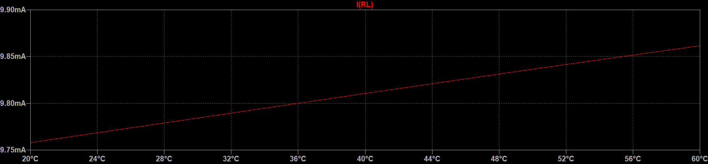
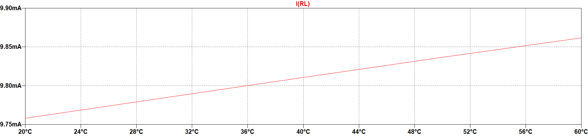

<!-- Wortlaut und Gliederung: HCW_BA/MA_Abschlussarbeit_englisch_V1.dotx. Technische Ergänzungen ausschließlich am Kapitelende. -->

# Chapter title {#sec-kapitel2}

Each chapter begins on a new page. This helps organize the document and makes it easier for readers to follow. Within a chapter, however, this does not apply to sections and subsections; these follow immediately after the main text.

## Section heading {#sec-kapitel2-abschnitt1}

Program code can also be inserted at appropriate places; see Listing \ref{lst-fibonacci} and the list of listings at the end of the document. Program code is displayed in the Courier font, which ensures that all characters are the same width.

```{=latex}
\begin{lstlisting}[caption={Calculating and printing a sequence of Fibonacci numbers.},label={lst-fibonacci}]
#include <stdio.h>
int main()
{
int i, n, t1 = 0, t2 = 1, nextTerm;
printf("Enter the number of terms: ");
scanf("%d", &n);
printf("Fibonacci Series: ");
for (i = 1; i <= n; ++i)
{
printf("%d, ", t1);
nextTerm = t1 + t2;
t1 = t2;
t2 = nextTerm;
}
return 0;
}
\end{lstlisting}
```

Note: A heading is always immediately followed by text -- not by a figure, table, equation, or listing!

## Section heading {#sec-kapitel2-abschnitt2}

As mentioned earlier, an outline consisting of only a single section should be avoided. Therefore, in addition to section \ref{sec-kapitel2-abschnitt1}, there must be at least section \ref{sec-kapitel2-abschnitt2}.[^3]

### Subsection heading {#sec-kapitel2-unterabschnitt1}

When choosing colors for graphs and tables, it is also important to ensure good contrast. Figure \ref{fig-kontrast} shows the same graph for comparison, once with poor contrast and once with good contrast.

::: {#fig-kontrast layout-ncol=1 fig-pos="H" fig-scap="Graph with poor (top) and good (bottom) contrast."}

{width=100%}

{width=100%}

Graph with poor (top) and good (bottom) contrast.

:::

The lower graph in Figure \ref{fig-kontrast} with good contrast is also better for printing because it uses significantly less toner or ink, respectively!

### Subsection heading {#sec-kapitel2-unterabschnitt2}

A document structure with only a single subsection should be avoided. Therefore, there must be at least one additional subsection (i.e., at the same level in the table of contents).

## Hinweise zu Latex {#sec-kapitel2-hinweise}

### Program code and lists

The original C example uses LaTeX's `lstlisting` environment. It automatically creates the caption “Listing 2.1” and the corresponding list entry. TeX Gyre Cursor is used as a free Courier alternative for this program code only; body text remains TeX Gyre Heros.

Chapters start on a new page automatically. Sections and subsections use `##` and `###`. LaTeX keeps headings with the following text; fixed page numbers from Word are not copied.

`layout-ncol=1` stacks the contrast graphics vertically. References and lists are updated when the PDF is built. Further Markdown and LaTeX examples are documented in `internal/docs/markdown-und-latex.md`.

[^3]: A footnote always appears on the same page as the reference to it. Therefore, text at the bottom of a page that contains a reference to the footnote will be moved to a new page if there is not enough space for the main text [and]{.underline} footnote.
