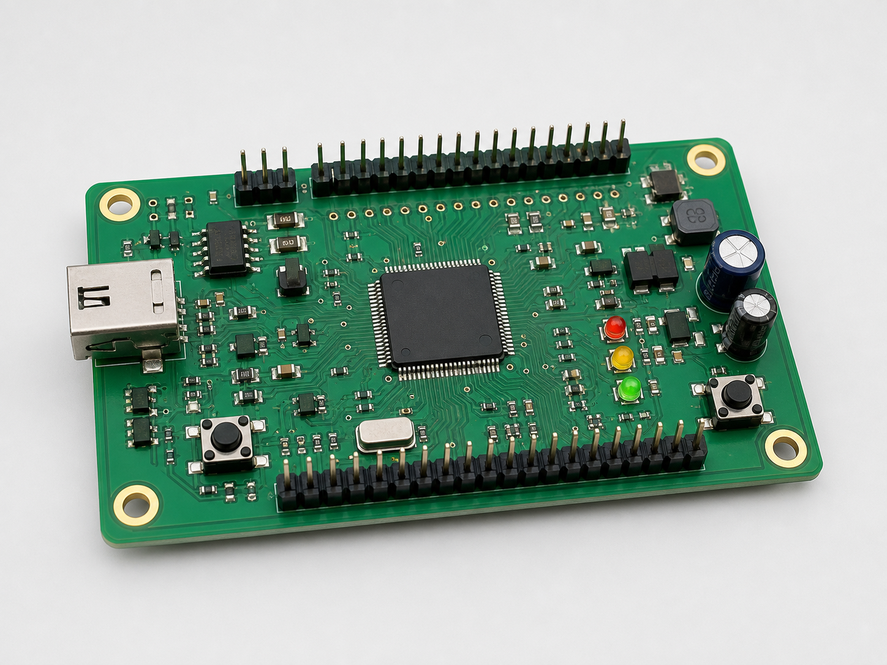

# Schreiben mit Markdown und LaTeX

[← Quick Start und Inhaltsverzeichnis](../../README.md)

Dateipfade beziehen sich auf den Projektstamm. Terminalbefehle werden dort ausgeführt.

Quarto-Markdown verwendet für normale Inhalte eine einfache Textsyntax. Die
Quelldateien bleiben dadurch gut lesbar und können mit jedem Texteditor
bearbeitet werden.

## Überschriften und Absätze

Überschriften werden mit `#` geschrieben. Ein einzelnes `#` bezeichnet in
diesem Buchprojekt ein Kapitel, zwei `##` einen Abschnitt und drei `###` einen
Unterabschnitt:

```markdown
# Methodik

Das ist ein normaler Absatz. Ein neuer Absatz beginnt nach einer Leerzeile.

## Datenerhebung

### Auswahl der Stichprobe
```

Kapitel sollten nur in den Dateien beginnen, die im gewählten Sprachprofil
`_quarto-de.yml` oder `_quarto-en.yml` unter `book.chapters` eingetragen sind.

## Hervorhebungen, Listen und Links

```markdown
Dieser Text ist **fett**, dieser Text ist *kursiv* und dieses Wort ist
`technischer Code`.

- erster Punkt
- zweiter Punkt
  - eingerückter Unterpunkt

1. erster Schritt
2. zweiter Schritt

[Quarto-Dokumentation](https://quarto.org/docs/)
```

## Formeln

Eine Formel innerhalb eines Satzes wird mit einfachen Dollarzeichen
geschrieben, beispielsweise `$U = R \cdot I$`.

Eine abgesetzte, nummerierte Formel erhält ein Label mit dem Präfix `eq-`:

```markdown
$$
U = R \cdot I
$$ {#eq-ohmsches-gesetz}
```

Im Fließtext wird mit `@eq-ohmsches-gesetz` darauf verwiesen:

```markdown
Aus @eq-ohmsches-gesetz folgt der elektrische Widerstand.
```

Quarto erzeugt daraus automatisch die richtige Formelnummer. Wenn Formeln
hinzugefügt oder verschoben werden, werden alle Verweise beim nächsten Build
aktualisiert.

Komplexere Formeln verwenden dieselbe LaTeX-Schreibweise. Ein gewichteter
Mittelwert mit Summen im Zähler und Nenner wird beispielsweise so geschrieben:

```markdown
$$
\bar{x}_w
=
\frac{\displaystyle\sum_{i=1}^{n} w_i x_i}
     {\displaystyle\sum_{i=1}^{n} w_i}
$$ {#eq-gewichteter-mittelwert}
```

Mit `aligned` lassen sich mehrere zusammengehörige Formelzeilen am
Gleichheitszeichen ausrichten. Das folgende Beispiel kombiniert mehrere
Brüche, Integrale und eine Summe:

```markdown
$$
\begin{aligned}
a_n
&=
\frac{2}{L}
\int_{0}^{L}
f(x)\cos\left(\frac{2\pi n x}{L}\right)
\,\mathrm{d}x,
\\
b_n
&=
\frac{2}{L}
\int_{0}^{L}
f(x)\sin\left(\frac{2\pi n x}{L}\right)
\,\mathrm{d}x,
\\
f_N(x)
&=
\frac{a_0}{2}
+
\sum_{n=1}^{N}
\left[
a_n\cos\left(\frac{2\pi n x}{L}\right)
+
b_n\sin\left(\frac{2\pi n x}{L}\right)
\right].
\end{aligned}
$$ {#eq-fourier-approximation}
```

Diese zusätzlichen Syntaxbeispiele ergänzen die Formeln aus den offiziellen
V1-Vorlagen. Deren gerenderte Beispiele mit deutschen und englischen
Erklärungen stehen in `content/chapters/de/03-methodik.qmd` beziehungsweise
`content/chapters/en/03-methodology.qmd`.

## Tabellen

Einfache Tabellen werden direkt in Markdown geschrieben:

```markdown
| Messgröße | Formelzeichen | Wert |
|---|:---:|---:|
| Spannung | U | 5,0 V |
| Strom | I | 20 mA |

: Elektrische Messwerte {#tbl-messwerte}
```

Die Doppelpunkte in der Trennzeile steuern die Ausrichtung. Im Beispiel ist die
zweite Spalte zentriert und die dritte rechtsbündig. Die Zeile unter der Tabelle
ist die Tabellenbeschriftung. Das Label beginnt mit `tbl-`.

Ein Verweis wird so geschrieben:

```markdown
Die Ergebnisse sind in @tbl-messwerte zusammengefasst.
```

Sehr breite oder komplexe Tabellen können bei Bedarf mit eingebettetem LaTeX
erstellt werden. Für normale Datentabellen sollte Markdown bevorzugt werden.

## Bilder und Abbildungen

Bilder werden im Verzeichnis `content/images/` gespeichert. Unterstützt werden unter
anderem PNG, JPEG und PDF. Für Fotos und Rastergrafiken eignet sich PNG oder
JPEG; Diagramme und andere Vektorgrafiken sollten nach Möglichkeit als PDF
eingebunden werden.

Vom Projektstamm wird ein Bild so eingebunden:

```markdown
{#fig-microcontroller width=75% fig-alt="Grüne Leiterplatte mit einem zentralen Microcontroller und elektronischen Bauteilen"}
```

Aus einer Datei in `content/chapters/de/` oder `content/chapters/en/` führt der
relative Pfad zwei Ebenen nach oben nach `content/` und von dort nach `images/`:

```markdown
{#fig-microcontroller width=75% fig-alt="Grüne Leiterplatte mit einem zentralen Microcontroller und elektronischen Bauteilen"}
```

Die Bestandteile sind:

- Der Text in `![...]` ist die sichtbare Bildunterschrift.
- Der Pfad in `(...)` verweist auf die Bilddatei.
- `#fig-microcontroller` ist das eindeutige Label der Abbildung.
- `width=75%` legt die relative Bildbreite fest.
- `fig-alt` beschreibt den Bildinhalt für barrierearme Ausgaben.

Im Text kann anschließend automatisch auf die Abbildung verwiesen werden:

```markdown
Der verwendete Aufbau ist in @fig-microcontroller dargestellt.
```

Das zusätzliche Beispielbild liegt unter `content/images/microcontroller.png` und
kann mit dem gezeigten Code eingebunden werden. Die tatsächlich gerenderten
V1-Bildbeispiele in `content/chapters/de/04-ergebnisse.qmd` und
`content/chapters/en/04-results.qmd` verwenden `content/images/v1/`.
Bilddateien sollten aussagekräftige Namen ohne Leerzeichen besitzen. Groß-
und Kleinschreibung muss mit dem Pfad im Markdown exakt übereinstimmen.

## Querverweise

Labels müssen innerhalb der ausgewählten Sprachfassung eindeutig sein. Die
parallele deutsche und englische Vorlage dürfen dieselben Labels verwenden,
weil immer nur eine Fassung geladen wird. Die Präfixe bestimmen den Typ des
referenzierten Elements:

```text
fig-   Abbildungen
tbl-   Tabellen
eq-    Formeln
sec-   Abschnitte
```

Auch Abschnitte können ein Label erhalten:

```markdown
## Versuchsaufbau {#sec-versuchsaufbau}

Wie in @sec-versuchsaufbau beschrieben, ...
```

Keine Nummern wie „Abbildung 3“ oder „Tabelle 2“ manuell in den Text schreiben.
Die `@...`-Verweise bleiben richtig, auch wenn Inhalte später verschoben werden.

## Codeblöcke

Programmcode wird mit drei Backticks eingeschlossen. Die Sprache nach den
öffnenden Backticks aktiviert die Syntaxhervorhebung:

````markdown
```c
int main(void) {
    return 0;
}
```
````

Dieser Code wird nur dargestellt und nicht ausgeführt. Ausführbare Codezellen
für Python, R oder Julia benötigen zusätzliche Laufzeiten und sind in der
aktuellen Docker-Vorlage nicht vorkonfiguriert.

## Fußnoten

```markdown
Diese Aussage benötigt eine ergänzende Erklärung.^[Text der Fußnote.]
```

Quarto nummeriert Fußnoten automatisch und setzt sie in der PDF an die passende
Position.

## Kleines Markdown-Beispiel

Normaler Inhalt wird als Markdown geschrieben:

```markdown
# Einleitung

Das ist ein Absatz mit einer Quelle [@mustermann2025].

## Forschungsfrage

Welche Auswirkungen hat ...?
```

## LaTeX für Sonderfälle

Normaler Inhalt sollte in Markdown geschrieben werden. Dadurch bleiben
Quelldateien lesbar und Quarto kann Nummerierung, Querverweise und andere
Ausgabeformate korrekt verarbeiten. Direktes LaTeX ist für einzelne
PDF-spezifische Layoutanforderungen vorgesehen, die sich mit Markdown nicht
sinnvoll ausdrücken lassen.

### LaTeX innerhalb eines Absatzes

Raw-LaTeX kann mit der Pandoc-Attributsyntax in einen Markdown-Absatz
eingebettet werden:

```markdown
Der Begriff `\textsc{Versuchsaufbau}`{=latex} wird in Kapitälchen gesetzt.
```

Für Fett- oder Kursivschrift ist weiterhin normales Markdown vorzuziehen:

```markdown
Dieser Text ist **fett** und dieser Text ist *kursiv*.
```

### LaTeX-Blöcke

Mehrzeiliges LaTeX steht in einem Raw-LaTeX-Block:

````markdown
```{=latex}
\begin{center}
  \fbox{
    \parbox{0.75\textwidth}{
      Dieser Kasten wird direkt von LaTeX gesetzt.
    }
  }
\end{center}
```
````

Auch ein erzwungener Seitenumbruch kann so geschrieben werden:

````markdown
```{=latex}
\newpage
```
````

### Zusätzliche LaTeX-Pakete

Zusätzliche Pakete werden nicht in einer `.qmd`-Datei und nicht unter
`_extensions/` eingetragen. Thesis-spezifische Pakete gehören in
`internal/latex/preamble.tex`:

```latex
\usepackage{pdflscape}
```

`pdflscape` ist in dieser Vorlage bereits eingebunden und im Builder-Image
vorhanden. Damit kann beispielsweise eine breite Tabelle auf einer
Querformatseite gesetzt werden:

````markdown
```{=latex}
\begin{landscape}
\begin{center}
\begin{tabular}{llllll}
\toprule
Messung & Spannung & Strom & Leistung & Temperatur & Status \\
\midrule
A & 5 V & 20 mA & 100 mW & 23 °C & gültig \\
B & 12 V & 15 mA & 180 mW & 25 °C & gültig \\
\bottomrule
\end{tabular}
\end{center}
\end{landscape}
```
````

Ein `\usepackage{...}`-Eintrag kann nur ein Paket laden, das bereits im
versionierten Builder-Image installiert ist. Meldet LaTeX
`File ... .sty not found`, muss das Paket kontrolliert in den
`hcw-document-builder` aufgenommen werden. Eine Installation während eines
normalen Builds ist wegen der Offline- und Reproduzierbarkeitsanforderungen
nicht vorgesehen.

Raw-LaTeX wird nur in der PDF-Ausgabe verarbeitet. Bei einer späteren
HTML-Ausgabe wird solcher Inhalt nicht automatisch in HTML übersetzt. Außerdem
liegen Raw-LaTeX-Tabellen und -Abbildungen außerhalb von Quartos automatischem
Querverweissystem. Wenn `@tbl-...`- oder `@fig-...`-Verweise benötigt werden,
sollten deshalb möglichst die dokumentierten Markdown-Varianten verwendet
werden.

[Zurück zum Inhaltsverzeichnis](../../README.md#inhaltsverzeichnis)
